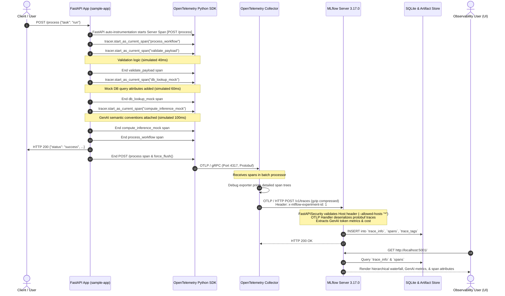

# Deep-Dive Architecture & Trace Processing Guide

This document provides a comprehensive technical breakdown of how distributed traces flow through the **OpenTelemetry Application $\rightarrow$ OpenTelemetry Collector $\rightarrow$ MLflow 3.17.0** pipeline, explaining the engineering decisions, network protocols, data transformations, and storage mechanisms.

---

## 1. End-to-End Trace Lifecycle & Sequence Diagram

The following sequence diagram illustrates the lifecycle of a request from client invocation to persistence and visualization in MLflow:



---

## 2. Core Architectural Pillars

### A. Pure OpenTelemetry in the Application (Zero Vendor Lock-In)
* **Design Philosophy:** The application code (`main.py`) does **not** import `mlflow`. It relies purely on the official OpenTelemetry SDK (`opentelemetry-api`, `opentelemetry-sdk`, `opentelemetry-instrumentation-fastapi`).
* **Why this matters:** If your organization switches from MLflow to Jaeger, Datadog, Honeycomb, or Tempo, **zero application lines need to change**. Only the collector export config is updated.

### B. The OpenTelemetry Collector as an Intelligent Gateway
* **Protocol Decoupling:**
  * **Ingress (App $\rightarrow$ Collector):** High-throughput, low-overhead binary **gRPC** on port `4317`.
  * **Egress (Collector $\rightarrow$ MLflow):** **OTLP/HTTP** on port `5000` (`/v1/traces`). MLflow 3.17.0 only provides an HTTP ingestion endpoint, not a native gRPC server. The collector bridges this protocol divide seamlessly.
* **Metadata Injection:** The collector injects the required routing header `x-mlflow-experiment-id: "1"`. Applications don't need to know which MLflow experiment stores their telemetry.
* **Network & Storage Efficiency:** The collector enables `compression: gzip`, drastically cutting network bandwidth between collectors and MLflow servers in distributed setups.
* **Local Debuggability:** The collector runs a `debug` exporter alongside `otlphttp`, allowing developers to inspect live Protobuf payloads directly in container logs.

### C. MLflow 3.17.0 as a Native OpenTelemetry Backend
* **Native OTLP Ingestion:** In MLflow 3.x, MLflow exposes a standards-compliant `/v1/traces` endpoint matching the official OpenTelemetry HTTP Traces specification.
* **Prerequisites for Trace Storage:**
  1. **SQL-Backed Tracking Store:** SQLite (`sqlite:////mlflow/mlflow.db`) or PostgreSQL/MySQL. File-based backend stores (`file://...`) do **not** support the OTLP trace backend in MLflow 3.x.
  2. **Artifact Root:** `--default-artifact-root /mlflow/artifacts` is mandatory for storing large span outputs and multimodal payloads.
  3. **Security Middleware Configuration:** MLflow 3.x introduced strict Host header validation (`mlflow.server.fastapi_security`). Supplying `--allowed-hosts "*"` in containerized/orchestrated topologies prevents `403 Forbidden: Rejected request with invalid Host header` errors when other containers reach MLflow using Docker service names (e.g., `http://mlflow-server:5000`).

---

## 3. Span Hierarchy & GenAI Semantic Conventions

Every call to `/process` constructs a four-tier hierarchical span structure conforming to OpenTelemetry semantic conventions:

```text
[Server Span] POST /process  (auto-instrumented by FastAPIInstrumentor)
│
└── [Workflow Span] process_workflow
    │
    ├── [Child 1] validate_payload
    │     ├── validation.status = "passed"
    │     └── validation.schema_version = "v1.2"
    │
    ├── [Child 2] db_lookup_mock
    │     ├── db.system = "postgresql"
    │     ├── db.name = "rag_knowledge_base"
    │     ├── db.operation = "SELECT"
    │     └── db.statement = "SELECT context, source FROM knowledge_chunks WHERE ..."
    │
    └── [Child 3] compute_inference_mock
          ├── gen_ai.operation.name = "chat"
          ├── gen_ai.provider.name = "anthropic"
          ├── gen_ai.request.model = "claude-3-5-sonnet"
          ├── gen_ai.request.temperature = 0.7
          ├── gen_ai.request.max_tokens = 1024
          ├── gen_ai.response.finish_reasons = ["stop"]
          ├── gen_ai.usage.prompt_tokens = 128
          ├── gen_ai.usage.completion_tokens = 256
          ├── gen_ai.usage.total_tokens = 384
          ├── custom.cache_hit = false
          └── custom.latency_target_met = true
```

### Automatic MLflow GenAI Extraction
Because the attributes follow standard OpenTelemetry GenAI naming conventions, MLflow automatically computes:
* **Token Usage:** Aggregated into `mlflow.trace.tokenUsage` (`input_tokens: 128`, `output_tokens: 256`, `total_tokens: 384`).
* **Estimated Cost:** MLflow matches the model (`claude-3-5-sonnet`) and token counts against internal cost models, creating `mlflow.trace.cost` metadata.

---

## 4. Under the Hood: SQLite Storage Schema

When MLflow receives traces via `/v1/traces`, it commits them to the SQL database (`/mlflow/mlflow.db`). The core tables involved include:

| Table Name | Purpose | Key Columns |
| :--- | :--- | :--- |
| `experiments` | Stores experiments (`otel-trace-storage` with ID `1`) | `experiment_id`, `name`, `lifecycle_stage` |
| `trace_info` | High-level summary of each distributed trace | `trace_id`, `experiment_id`, `timestamp_ms`, `execution_time_ms`, `status` |
| `trace_tags` | Key-value tags describing service and environment | `trace_id`, `key`, `value` (`service.name`, `deployment.environment`) |
| `spans` | Individual spans within the trace hierarchy | `span_id`, `parent_span_id`, `trace_id`, `name`, `model_name`, `model_provider`, `total_cost`, `content` |

You can inspect the raw SQLite records anytime using:

```bash
docker exec mlflow-server python -c "
import sqlite3
conn = sqlite3.connect('/mlflow/mlflow.db')
c = conn.cursor()
c.execute('SELECT span_id, parent_span_id, name, model_name FROM spans LIMIT 10;')
for row in c.fetchall():
    print(row)
"
```

---

## 5. Port Mapping Rationale

| Service | Internal Port | Host Port | Reason |
| :--- | :--- | :--- | :--- |
| `sample-app` | `8000` | `8000` | Standard FastAPI application port. |
| `otel-collector` | `4317` / `4318` | `4317` / `4318` | Standard OTLP gRPC and HTTP receiver ports. |
| `otel-collector` | `13133` | `13133` | OTel health_check extension endpoint. |
| `mlflow-server` | `5000` | **`5001`** | **macOS Conflict Prevention:** On macOS Monterey and later, Apple's `ControlCenter` (AirPlay Receiver) binds to `*:5000` by default. Mapping host port `5001` to container port `5000` allows the container to run on standard port 5000 while preventing host port collisions. |

---

## 6. Verification Cheat Sheet

### 1. Test Component Health
```bash
curl -f http://localhost:5001/health   # MLflow
curl -f http://localhost:13133/        # OTel Collector
curl -f http://localhost:8000/health   # Sample App
```

### 2. Trigger Sample Trace
```bash
curl -X POST http://localhost:8000/process \
  -H "Content-Type: application/json" \
  -d '{"task": "summarize", "user_id": 42}'
```

### 3. Verify in Collector Logs
```bash
docker compose logs --tail 30 otel-collector
```

### 4. Query Stored Traces via REST API
```bash
# MLflow 3.x Unified Trace Search
curl -s -X POST http://localhost:5001/api/3.0/mlflow/traces/search \
  -H "Content-Type: application/json" \
  -d '{"locations": [{"type": "MLFLOW_EXPERIMENT", "mlflow_experiment": {"experiment_id": "1"}}]}' | jq .

# MLflow 2.x Compatibility Endpoint
curl -s -G http://localhost:5001/api/2.0/mlflow/traces \
  --data-urlencode "experiment_ids=1" | jq .
```

### 5. Access Interactive Web UI
Open your browser to:
[http://localhost:5001](http://localhost:5001) $\rightarrow$ Select `otel-trace-storage` $\rightarrow$ Click **Traces**.
