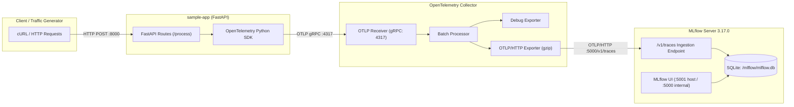

# OpenTelemetry to MLflow 3.17.0 Trace Storage Lab

A production-pattern observability stack demonstrating how an OpenTelemetry-instrumented application sends distributed traces to an OpenTelemetry Collector, which forwards them to an **MLflow 3.17.0** server acting strictly as the trace storage and visualization backend.

---

## Architecture Overview



### Key Technical Aspects
1. **Pure OpenTelemetry Instrumentation:** `sample-app` imports zero MLflow packages. Tracing is 100% vendor-agnostic OpenTelemetry SDK code.
2. **Collector HTTP Export:** MLflow 3.17.0 trace ingestion supports standard OTLP/HTTP at `/v1/traces` (not OTLP/gRPC). The collector uses `otlphttp` pointing to `http://mlflow-server:5000`, which automatically routes to `/v1/traces`.
3. **Target Experiment Header:** Collector config sets `x-mlflow-experiment-id: "1"` so incoming traces are routed to the dedicated `otel-trace-storage` experiment.
4. **Compression:** Enabled `compression: gzip` in the collector's `otlphttp` exporter.
5. **Rich Nested Spans:** Calls to `/process` generate nested child spans (`validate_payload`, `db_lookup_mock`, `compute_inference_mock`) with standard GenAI semantic conventions (`gen_ai.operation.name`, `gen_ai.provider.name`, `gen_ai.request.model`, token counts).

---

## Directory Structure

```text
mlflow-otel-lab/
├── docker-compose.yml          # Container orchestration (mlflow, collector, app)
├── otel-collector-config.yaml  # OTel Collector pipeline & exporter configuration
├── PROCESS.md                  # Comprehensive technical deep-dive & sequence diagram
├── app/
│   ├── Dockerfile              # Python 3.11-slim container definition
│   ├── requirements.txt        # FastAPI, Uvicorn, and OpenTelemetry SDK packages
│   └── main.py                 # FastAPI app with nested OpenTelemetry spans
└── README.md                   # Documentation and verification guide
```

For a comprehensive explanation of the architecture, sequence diagrams, GenAI semantic conventions, and SQLite schema, see [PROCESS.md](file:///Users/ayoubelmaaradi/labi/mlflow-tracing/mlflow-otel-lab/PROCESS.md).

---

## Quickstart

### 1. Start the Stack
From the `mlflow-otel-lab/` directory:

```bash
docker compose up -d --build
```

### 2. Verify Health of Components

```bash
# Check MLflow server health
curl -f http://localhost:5001/health

# Check OTel Collector health check extension
curl -f http://localhost:13133/

# Check Sample App health
curl -f http://localhost:8000/health
```

### 3. Generate Trace Traffic
Send requests to `/process` to create traces with nested spans:

```bash
for i in {1..5}; do
  curl -s -X POST http://localhost:8000/process \
    -H "Content-Type: application/json" \
    -d "{\"request_id\": $i, \"prompt\": \"Summarize system status\"}" | jq .
done
```

### 4. Check OTel Collector Logs
Inspect the debug exporter logs in the collector to verify span processing:

```bash
docker compose logs otel-collector
```

### 5. Query Persisted Traces in MLflow
Search for traces stored in experiment ID `1` via MLflow's REST API:

```bash
curl -s -X POST http://localhost:5001/api/2.0/mlflow/traces/search \
  -H "Content-Type: application/json" \
  -d '{"experiment_ids": ["1"]}' | jq .
```

### 6. Inspect Traces in the MLflow UI
Open your browser to:
[http://localhost:5001](http://localhost:5001)

1. Select the **otel-trace-storage** experiment.
2. Click on the **Traces** tab to inspect the hierarchical span tree, latency waterfalls, GenAI token counts, and span attributes.

---

## Teardown

To stop and remove all containers and volumes:

```bash
docker compose down -v
```
